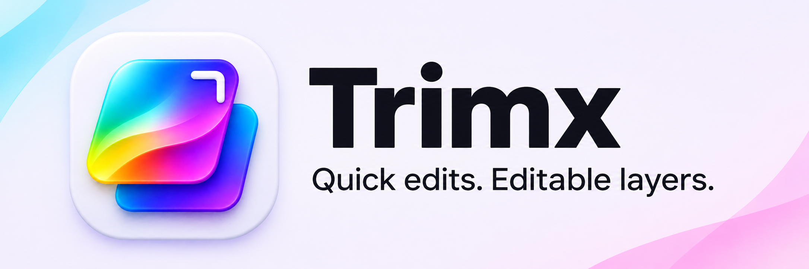
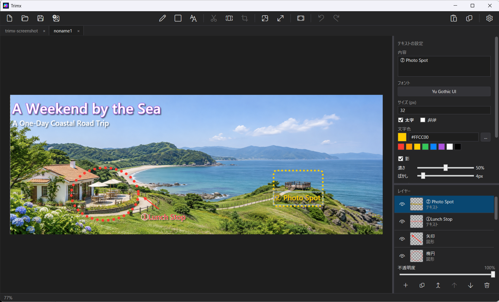

# Trimx

English | [日本語](README.ja.md)

A lightweight image editor for Windows 11. It is built for one workflow: take a screenshot with `Win + Shift + S`, then quickly edit, annotate, and export the image from the clipboard.

Trimx has no screen-capture feature of its own. It relies on the built-in Windows tool.



## Concept

- The convenience and fast startup of the Snipping Tool
- Photoshop-style layer editing (text and shapes stay editable)
- A single window with tabs for multiple images
- Tight clipboard integration

## Features

| Area | Details |
|---|---|
| Import | Auto-loads the clipboard image at startup / paste (Ctrl+V) / open files or drag and drop (PNG, JPEG, WebP, BMP, `.trimx`) |
| Layers | Image, text, and shape layers (rectangle, ellipse, arrow, line). Visibility, opacity, reordering, duplicate, merge down, rasterize, thumbnails |
| Editing | Pen, text (bold, italic, shadow, outline), shape stroke style and corner radius, rectangular selection, crop, cut, canvas and image resize |
| History | Undo / Redo (Ctrl+Z / Ctrl+Y), unsaved-changes prompt |
| Output | Export to PNG / JPEG / WebP, copy to the clipboard, save as a project (`.trimx`) |
| View | Zoom around the cursor, fit (Ctrl+0), 100% (Ctrl+1), dark / light theme |

See section 7.2 of the [specification](docs/plan.md) (Japanese) for the full list of shortcuts.

## Install

Download the installer (`Trimx-<version>-win-x64-setup.exe`) or the portable zip (`Trimx-<version>-win-x64.zip`) from the [Releases](https://github.com/shin32t/Trimx/releases) page. The installer does not need administrator rights and installs to `%LOCALAPPDATA%\Programs\Trimx` by default.

> **Windows SmartScreen warning:** Trimx is not code-signed, so Windows may show "Windows protected your PC" when you run the installer. Click **More info**, then **Run anyway**.

## Tech stack

| Item | Technology |
|---|---|
| OS | Windows 11 (x64) |
| Language / runtime | C# / .NET 10 |
| UI | WPF |
| Rendering engine | [SkiaSharp](https://github.com/mono/SkiaSharp) |
| Project format | `.trimx` (ZIP container: `project.json` + one PNG per layer) |

The only NuGet packages are `SkiaSharp` and `SkiaSharp.Views.WPF`, to keep the app light.

## Project layout

```text
Trimx.slnx
├── src/
│   ├── Trimx.Core/   WPF-independent core (net10.0)
│   │   ├── Documents/   ImageDocument / Layer (Image, Text, Shape)
│   │   ├── Rendering/   SkiaSharp rendering and export
│   │   ├── Commands/    Undo / Redo commands
│   │   ├── Editing/     Document and layer factories
│   │   └── Services/    Image import/export and project files
│   └── Trimx/        WPF UI (net10.0-windows10.0.19041.0)
│       ├── UI/          MainWindow, canvas, tabs, panels, dialogs
│       └── Services/    Clipboard, settings, BitmapConverter
├── docs/             Specification (plan.md, Japanese)
├── installer/        Release build script and Inno Setup script
├── .ai/              Shared context for AI coding tools
└── AGENTS.md, CLAUDE.md, GEMINI.md, .github/, .cursor/   Entry points for each AI tool
```

Design principles:

- Document and Layer do not depend on WPF. Layer management and rendering are separate.
- Every UI operation is a command on the Document, so it can be undone and redone.
- Startup speed comes first; heavy initialization is deferred.

## Build and run

Requirements: .NET 10 SDK, Windows 11.

```powershell
dotnet build Trimx.slnx
dotnet run --project src/Trimx/Trimx.csproj
```

> Keep `TargetFramework` at `net10.0-windows10.0.19041.0`. With `windows7.0`, SkiaSharp.Views.WPF falls back to its .NET Framework build.

## Packaging

`installer/build.ps1` publishes the app (win-x64, self-contained .NET runtime, ReadyToRun), creates a portable zip, and builds an installer if Inno Setup 6 or later is available. Output goes to `installer/output/`. The binaries are not code-signed, so Windows SmartScreen shows a warning.

Releases are created by GitHub Actions (`.github/workflows/release.yml`). Set `<Version>` in `src/Trimx/Trimx.csproj`, then push a tag such as `v0.2.0`; a draft release with the installer and zip is created for review.

## Where data is stored

Trimx creates two files in `%LOCALAPPDATA%\Trimx\`:

- `TrimxSetting.json`: options chosen in the settings dialog (theme, toolbar labels, etc.)
- `TrimxState.json`: things the app remembers on its own (last image size, my colors, last pen / text / shape appearance, etc.)

## Status

| Phase | Scope | Status |
|---|---|---|
| Phase 1 | Basic app (image display, zoom, clipboard) | Done |
| Phase 2 | Document, tabs, layers | Done |
| Phase 3 | Editing, Undo / Redo | Done |
| Phase 4 | Save, export, copy | Done |
| Phase 5 | Single instance, optimization | Not started |

Mouse and keyboard interactions have only been partly verified on a real screen. Build, startup, Core behavior, button operations, and confirmation dialogs have been verified.

## Documentation

| Location | Contents | Audience |
|---|---|---|
| [docs/plan.md](docs/plan.md) | Specification and development phases (Japanese; the primary source for requirements) | Humans |
| [.ai/](.ai/README.md) | Context for AI coding tools (English) | AI |

## Developing with AI tools

Shared context for Claude Code, Codex, Gemini CLI, GitHub Copilot, and Cursor lives in `.ai/`. The files each tool reads (`AGENTS.md`, `CLAUDE.md`, `GEMINI.md`, `.github/copilot-instructions.md`, `.cursor/rules/`) are thin pointers to it. See [.ai/README.md](.ai/README.md).

## License

[MIT License](LICENSE). Licenses of third-party dependencies are listed in [THIRD-PARTY-NOTICES.md](THIRD-PARTY-NOTICES.md).
